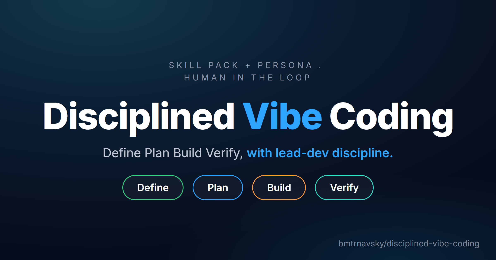

# A coding agent for non-engineers and vibe coders

## What it does

Disciplined Vibe Coding is a skill pack and persona for a coding agent
(built for Hermes; portable to any agent that supports skill files). It is
for someone who wants to build real software, from small fixes through
multi-week projects, without being a software engineer. It supplies the
discipline a senior lead would insist on: say what done looks like before
building, test before shipping, verify before claiming finished. You lean
on the loop instead of having to already know it.

## How it works

Every task runs one loop, start to finish, in the same order each time:

    Define (intake -> brainstorm) -> Plan (research <-> plan) -> Teardown -> Build (test-first -> execute <-> debug) -> Verify (verify -> version)

In plain words: you and the agent agree on what done means and write it
down (Define), shape the approach and check it against prior art (Plan),
confirm the job is still worth doing before any code changes (Teardown),
build it with tests written first (Build), then prove it worked and record
the result (Verify). One loop per small task, or per milestone of a larger
project. The repetition is deliberate: you learn the shape of good practice
by watching it applied the same way each time. Full pipeline with stages
and artifacts: `plugins/disciplined-vibe-coding/SKILL.md`. Using another
agent? See `READERS.md`.

What the loop refuses is covered by `tests/dvc_behavioural.py` (97/97
green; run it with `python tests/dvc_behavioural.py`): no building before
done is written down, no shipping past a failed check, no claiming success
because a command did not error, no committing secrets, no rounding a
near-miss up to good enough.

## Stakes-aware, not one-size-fits-all

Every task gets a tier: **TOY** (learning, nothing at risk), **WORKFLOW**
(your own systems could break), or **MONEY** (payments, live trading,
anything public-facing). The tier changes what gets asked, what gets a
rollback plan, and whether a stronger model reviews the work before it's
called finished.

## Why this instead of a strict checklist

This pack sizes the ceremony to the job: a small, low-risk fix gets one short
pass, and the heavier reviews, rollback plans, and second looks appear only as
the stakes rise. Every step is explained in plain words while it happens, so
someone who does not write code learns the shape of good practice instead of
just following orders. Strict checklists are written for engineers: they run the
full ritual on every task however small, with no exceptions, and assume you
already know why each step exists. That discipline is real, and this pack
borrows from it (see ATTRIBUTIONS.md). The difference is fit: if you want
identical rigor at every size and you already speak the language, a fixed
checklist suits you; if you want the rigor to grow with the risk and to teach
as it goes, use this.

## Install

Two ways in. Both are plain files; nothing to compile.

**Path A: Ask your agent.** Paste this sentence into your coding assistant:

> Install the disciplined-vibe-coding plugin from https://github.com/bmtrnavsky/disciplined-vibe-coding.

**Path B: Self install.**

1. Get the files: `git clone https://github.com/bmtrnavsky/disciplined-vibe-coding`, or download the ZIP from the same page and unzip it.
2. Copy the persona (`SOUL.md`) and the skills folder into your assistant, using its own instructions for where written guidance lives.
3. Open `USER.md.template`, fill in the bracketed lines about you and what you're building, and save it where your assistant reads it.
4. Per-assistant details (exactly which folders to copy, and what changes when your assistant has no skill loader) are in `READERS.md`.

## How to use it

**Install:** your helper sets it up in your profile: the personality, the
skill library, and a short note about you and what you're building. You
don't install anything yourself and you never have to edit a settings file.

**First run:** tell it what you want built, in your own words. "Add a
contact form to my site." "Make the invoice totals round correctly." It
asks what "done" means, writes that down, and shows you the answer before
it starts building. If your description is thin, it asks questions instead
of guessing.

**What to expect:** each step announces itself and says what it is doing
and why. When something cannot be proven, it stops and tells you rather
than carrying on quietly. At the end you get a short report: what changed,
what was checked, and what is still open.

**Day to day:** small jobs take one pass. Bigger projects break into
milestones, each with its own pass, so you always know where you are. You
can stop at any moment and ask "where are we?" and get a straight answer.

**Using a different assistant?** The same pack works with any assistant that
can load written instructions. The setup note in this repo covers the one
thing that changes.

Sibling project:
[spec-driven-data-analysis](https://github.com/bmtrnavsky/spec-driven-data-analysis)
applies the same discipline to data work: lock the spec before touching
the data, verify every run.

## What it won't do

It won't call something finished just because nothing crashed. It won't
skip the planning step on work that matters. It won't touch live money or
public-facing systems without a rollback plan and a second pair of eyes.
On small, low-risk jobs it stays light; the heavier checks appear when the
stakes do.

## License

MIT for everything original to this pack. The thirteen skills draw on
several MIT-licensed sources, and the elephant/goldfish framing is adapted
from Google's Elephant-Goldfish Model (Apache-2.0). See `ATTRIBUTIONS.md`
for lineage and `SOURCE-LICENSES.md` for the full license text and
copyright line of every upstream project. Those notices travel with this
pack per their license terms; keep them if you fork or redistribute.
