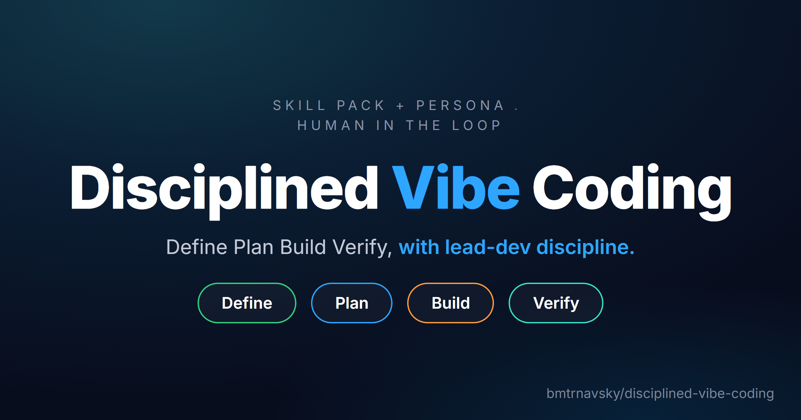

# A coding agent for non-engineers and vibe coders

A lean skill pack + persona for any coding agent (built for Hermes;
portable to any agent that supports skill files). For someone who wants to
build real software — small fixes through multi-week projects — without
being a software engineer, with lead-dev discipline explained in plain
language at every step.

This isn't a shortcut around learning. It's scaffolding: the same rigor a
senior engineer would insist on (define before building, test before
shipping, verify before claiming done), applied consistently so you can lean
on it instead of having to already know it.

## The loop

    Define (intake -> brainstorm) -> Plan (research <-> plan) -> Teardown -> Build (test-first -> execute <-> debug) -> Verify (verify -> version)

Full pipeline with gates and artifacts: `plugins/disciplined-vibe-coding/SKILL.md`
(Intake → Define → Economy gate → Plan → Teardown → Build → Verify → Commit, Wayfinder
riding along). Using another agent? See `READERS.md`.

One loop per small task, or per milestone of a larger project. Same four
words every time — the repetition is deliberate. You learn the shape of good
engineering practice by watching it applied the same way, over and over,
not by reading a lecture about it once.

## What it actually stops you from doing

- Building before anyone (you or the agent) has said out loud what "done"
  looks like.
- Shipping a destructive change with no rollback plan.
- Claiming something works because a command didn't error, rather than
  because someone actually checked the output.
- Storing payment card data instead of using a provider-hosted checkout.
- Running something autonomous (a bot, a scheduler) with no kill-switch.
- A near-miss on a metric getting quietly rounded up to "good enough."
- Moving past a failed gate without a logged bypass (who approved, what
  was red, why it was waived).
- Committing secrets: a secret scan runs before every commit.

## Stakes-aware, not one-size-fits-all

Every task gets a tier: **TOY** (learning, nothing at risk), **WORKFLOW**
(your own systems could break), or **MONEY** (payments, live trading,
anything public-facing). The tier changes what gets asked, what gets a
rollback plan, and whether a stronger model reviews the work before it's
called finished.

## Layout

    SOUL.md              the persona — how it talks, what it never compromises on
    USER.md.template      fill in your own background, environment, and preferences
    UPDATE.md             update contract: shipped paths read-only to you, user edits in user/
    scripts/update.sh     updater: replaces the pack, reapplies the overlay
    user/                 your overlay — customizations live here, never touched by updates
    scripts/selfcheck.sh  acceptance checks for the pipeline's hard rules
    HOOKS.md              optional shell hook for research-freshness nudges
    hooks/                the one hook this pack ships
    skills/               the ten skills that make up the loop
    plugins/disciplined-vibe-coding/
                          v0.2.0 pipeline overlay (stages, gates, rung rules),
                          economy ladder, to-spec/plan/wayfinder templates,
                          changelog
    READERS.md            use this pack from any agent with a skill loader
                          (or none — paste-per-stage fallback included)
    ATTRIBUTIONS.md        what this pack draws from, and where
    SOURCE-LICENSES.md    full license text and copyright lines for every source
    CATALOG.md            draft entry for the Hermes plugin catalog

## Install

**Hermes:** `SOUL.md` → your profile's `SOUL.md`; `skills/` → your profile's
skills directory (or a shared skills path referenced via
`skills.external_dirs`); `USER.md.template` → fill in and save as `USER.md`;
`hooks/` → optional, wire into `config.yaml` per `HOOKS.md` if you want the
research-freshness nudge.

**Pipeline orchestrator:** `plugins/disciplined-vibe-coding/SKILL.md` is the
entry skill that runs the whole loop; the root `__init__.py` registers it as
`disciplined-vibe-coding:disciplined-vibe-coding` alongside the ten stage
skills. Load this repo as a Hermes plugin (or point your loader at that
`SKILL.md`) so the loop has a driver — the stage skills alone have none.

**Elsewhere:** `SOUL.md` → your system prompt; the `SKILL.md` files → wherever
your tool loads skills from.

## License

MIT for everything original to this pack (`SOUL.md`, `USER.md.template`,
`HOOKS.md`, this README). The ten skills derive from several MIT-licensed
sources, and the pipeline's elephant/goldfish framing is adapted from
Google's Elephant-Goldfish Model (Apache-2.0). See `ATTRIBUTIONS.md` for
lineage and `SOURCE-LICENSES.md` for the full license text and copyright
line of every upstream project. Those notices travel with this pack per
their license terms; keep them if you fork or redistribute.
