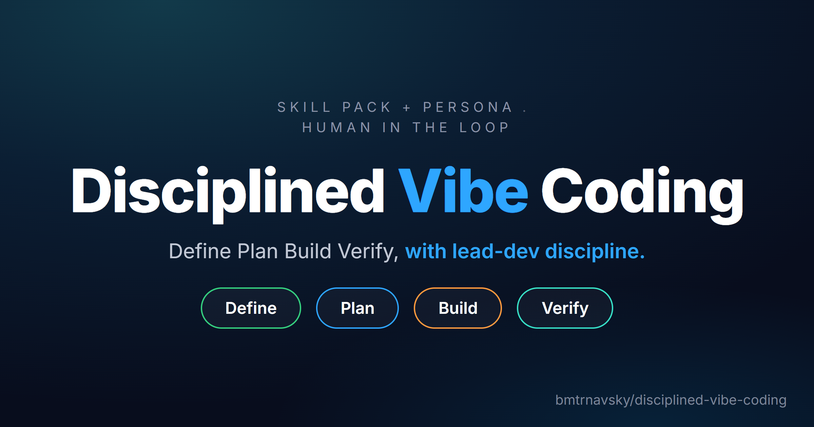

# A coding agent for non-engineers and vibe coders



[](LICENSE)
[](https://hermes-agent.nousresearch.com/docs)
[](plugins/disciplined-vibe-coding/CHANGELOG.md)

## What it does

Disciplined Vibe Coding is a skill pack and persona for a coding agent
(built for Hermes; portable to any agent that supports skill files). It is
for someone who wants to build real software — small fixes through
multi-week projects — without being a software engineer. It supplies the
discipline a senior lead would insist on: say what done looks like before
building, test before shipping, verify before claiming finished. You lean
on the loop instead of having to already know it.

## How it works

Every task runs one loop, start to finish, in the same order each time:

    Define (intake -> brainstorm) -> Plan (research <-> plan) -> Teardown -> Build (test-first -> execute <-> debug) -> Verify (verify -> version)

In plain words: you and the agent agree on what done means and write it
down (Define), shape the approach and check it against prior art (Plan),
confirm the job is still worth doing before any code changes (Teardown),
build it with tests written first (Build), then prove it worked and record
the result (Verify). One loop per small task, or per milestone of a larger
project. The repetition is deliberate: you learn the shape of good practice
by watching it applied the same way each time. Full pipeline with stages
and artifacts: `plugins/disciplined-vibe-coding/SKILL.md`. Using another
agent? See `READERS.md`.

What the loop refuses is covered by `tests/dvc_behavioural.py` (26/26
green; run it with `python tests/dvc_behavioural.py`): no building before
done is written down, no shipping past a failed check, no claiming success
because a command did not error, no committing secrets, no rounding a
near-miss up to good enough.

## Stakes-aware, not one-size-fits-all

Every task gets a tier: **TOY** (learning, nothing at risk), **WORKFLOW**
(your own systems could break), or **MONEY** (payments, live trading,
anything public-facing). The tier changes what gets asked, what gets a
rollback plan, and whether a stronger model reviews the work before it's
called finished.

## How to use it

**Install (Hermes):** copy `SOUL.md` into your profile's `SOUL.md`,
`skills/` into your profile's skills directory, fill in `USER.md.template`
and save it as `USER.md`. Then load this repo as a Hermes plugin — that
gives the loop its driver (`plugins/disciplined-vibe-coding/SKILL.md`).
Using another agent? `SOUL.md` becomes your system prompt and the
`SKILL.md` files load wherever your tool loads skills from; see
`READERS.md`.

**First run:** the runner executes Define through Verify with no human in
the loop:

```bash
python scripts/dvc_run.py --job "add a contact form" --workdir ./myjob --build "pytest -q"
```

**What good output looks like:** each stage prints a verdict line, and the
run ends with a report path:

```
[Define]
locked .pipeline/to-spec.md sha256:6650bfed936e
GATE PASS: G1 define/spec-locked — spec present and lock recorded.
GATE PASS: G2 economy/rung-declared — rung sentence declared in to-spec.
[Plan]
plan: .pipeline/plans/01-demo-job.md
GATE PASS: G3 plan/shaped — 01-demo-job.md: 4 non-empty lines.
...
report: myjob/.pipeline/run-report.md
```

A run that cannot prove its step stops and says so instead of continuing.
Give no `--build` command and it stops before review with `NOT BUILT`
rather than inventing a result (proven by
`test_no_build_reports_not_built` in the same suite).

Sibling project:
[spec-driven-data-analysis](https://github.com/bmtrnavsky/spec-driven-data-analysis)
applies the same discipline to data work — lock the spec before touching
the data, verify every run.

## Layout

    SOUL.md              the persona — how it talks, what it never compromises on
    USER.md.template      fill in your own background, environment, and preferences
    UPDATE.md             update contract: shipped paths read-only to you, user edits in user/
    scripts/update.sh     updater for manual checkouts only (catalog installs: `hermes plugins update disciplined-vibe-coding`)
    user/                 your overlay — customizations live here, never touched by updates
    scripts/dvc_run.py    the runner: Define → Verify with no human in the loop
    scripts/selfcheck.sh  lint-only string checks (proves nothing alone)
    tests/dvc_behavioural.py  behavioural tests: runs the real runner,
                              asserts on real output (`python tests/dvc_behavioural.py`)
    HOOKS.md              optional shell hook for research-freshness nudges
    hooks/                the one hook this pack ships
    skills/               the ten skills that make up the loop
    plugins/disciplined-vibe-coding/
                          v0.2.0 pipeline overlay (stages, gates, rung rules),
                          economy ladder, to-spec/plan/wayfinder templates,
                          changelog
    READERS.md            use this pack from any agent with a skill loader
                          (or none — paste-per-stage fallback included)
    ATTRIBUTIONS.md        what this pack draws from, and where
    SOURCE-LICENSES.md    full license text and copyright lines for every source
    CATALOG.md            draft entry for the Hermes plugin catalog

Engineers: gates, red-team history, and accepted risks live in
[docs/HARDENING.md](docs/HARDENING.md).

## License

MIT for everything original to this pack (`SOUL.md`, `USER.md.template`,
`HOOKS.md`, this README). The ten skills derive from several MIT-licensed
sources, and the pipeline's elephant/goldfish framing is adapted from
Google's Elephant-Goldfish Model (Apache-2.0). See `ATTRIBUTIONS.md` for
lineage and `SOURCE-LICENSES.md` for the full license text and copyright
line of every upstream project. Those notices travel with this pack per
their license terms; keep them if you fork or redistribute.
